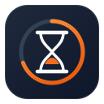
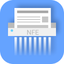
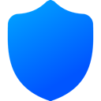

<h2 align="center">
  &nbsp; Productivity &amp; Task Management
</h2>

> ### &nbsp; [⭐️ Start Menu](https://github.com/nkhi/strongroots) &nbsp;<code>Personal Project</code>
>
> Combines daily to-do lists, habit tracking, and long-running notes into a single everything app that I host on my home server, using [Tailscale](https://tailscale.com/) and [Caddy](https://caddyserver.com/) to access it when I'm out and about. Replaces [Tweek](https://tweek.so/#), [Beaver Habit Tracker](https://github.com/daya0576/beaverhabits), and [Simplenote](https://simplenote.com/). Integrates [Memos](https://www.usememos.com/docs/installation/docker) as a durable, searchable notes solution.

 

  <h3>
    &nbsp; <a href="https://simplenote.com/">Simplenote</a>
  </h3>
  
Notes with fast cloud sync, useful on multiple devices. Searchable tags and Markdown.

   

  <h3>
    <picture>
      <source media="(prefers-color-scheme: dark)" srcset="./assets/icons/cron-calendar-light.png" />
      <source media="(prefers-color-scheme: light)" srcset="./assets/icons/cron-calendar.png" />
      
    </picture>&nbsp; <a href="https://www.notion.com/product/calendar">Cron Calendar</a>
  </h3>
  
<a href="https://www.notion.com/product/calendar">it is a calendar</a>

<!-- Simple weekly planner for short-term goals (<1wk)   Web-based, indie dev team, works on mobile & while logged out      |
|  | Clear habit tracker with streaks and data vis. Self-hosted, and the web app is a mobile PWA.  |
|  | Self-hosted Twitter-like personal diary in feed form. Capture ideas that aren't todos or notes. | -->

 
 

<h2 align="center">
  &nbsp; MacOS
</h2>

  <h3>
    &nbsp; <a href="https://sindresorhus.com/one-thing">One Thing</a>
  </h3>
  
Displays the current priority at a glance

   

  <h3>
    &nbsp; <a href="https://github.com/kristopherjohnson/MenubarCountdown">Menubar Countdown</a>
  </h3>
  
Displays a persistent timer at a glance

   

  <h3>
    &nbsp; <a href="https://goodsnooze.gumroad.com/l/macwhisper">MacWhipser</a>
  </h3>
  
Transcribe microphone recordings for longform recordings

   

  <h3>
    &nbsp; <a href="https://superwhisper.com/">Superwhisper</a>
  </h3>
  
Local speech-to-text with OpenAI Whisper. Great for short-form messages on Slack or iMessage, or prompting in Cursor.

 
 

<h2 align="center">
  &nbsp; Browser
</h2>

  <em><a href="https://privacytests.org/">*use a secure browser</a> + a vpn</em>

  <h3>
    &nbsp; <a href="https://github.com/jordwest/news-feed-eradicator">News Feed Eradicator</a>
  </h3>
  
Hide feeds everywhere.

   

  <h3>
    &nbsp; <a href="https://github.com/navorite/sessionic">Sessionic</a>
  </h3>
  
Compartmentalize tabs &amp; related contexts for later

   

  <h3>
    &nbsp; <a href="https://darkreader.org/">Dark Reader</a>
  </h3>
  
Dark mode everywhere

   

  <h3>
    &nbsp; <a href="https://chromewebstore.google.com/detail/whatfont/jabopobgcpjmedljpbcaablpmlmfcogm">Whatfont?</a>
  </h3>
  
Eyedropper for fonts

   

  <h3>
    &nbsp; <a href="https://addons.mozilla.org/en-CA/firefox/addon/user-agent-string-switcher/">User Agent Switcher</a>
  </h3>

   

  <h3>
    &nbsp; <a href="https://chromewebstore.google.com/detail/leechblock-ng/blaaajhemilngeeffpbfkdjjoefldkok">Leechblock NG</a>
  </h3>
  
Block websites you don't need to keep going on

   

  <h3>
    &nbsp; <a href="https://chromewebstore.google.com/detail/tabbit-tab-closer-organiz/calbmnbhppoplenhgpfejepklainehko">Tabbit</a>
  </h3>
  
Helps you close old tabs you don't need anymore, and manage window sprawl across sessions.

   

  <h3>
    &nbsp; <a href="https://github.com/arifwn/TinySuspender">Tiny Suspender</a>
  </h3>
  
Unload idle tabs to reduce memory and CPU usage.

   

  <h3>
    &nbsp; <a href="https://github.com/uBlockOrigin/uBOL-home">uBlock Origin Lite</a>
  </h3>
  
Permission-less MV3 content blocker for ads, trackers, and annoyances.

 
 

<h2 align="center">
  &nbsp; Android
</h2>

  <h3>
    &nbsp; <a href="https://nextdns.io/">NextDNS Manager</a>
  </h3>
  
Block websites like Leechblock but at the DNS level. Also remove ads &amp; telemetry trackers.

 
 

<h2 align="center">
  &nbsp; Audio
</h2>

  <h3>
    &nbsp; <a href="https://github.com/kristopherjohnson/MenubarCountdown">Nook</a>
  </h3>
  
Plays Animal Crossing music on the hour

   

  <h3>
    &nbsp; <a href="https://asoftmurmur.com/">A Soft Murmur</a>
  </h3>
  
Plays white noise

