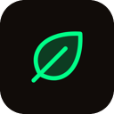
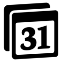
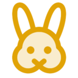
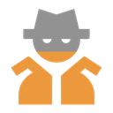
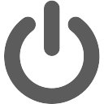

<h2 align="center">
  &nbsp; Productivity &amp; Task Management
</h2>

<table>
  <tr>
    <td width="882" align="center" valign="top">
       
      
      <h3><a href="https://github.com/nkhi/strongroots">⭐️ Start Menu</a></h3>
      

        Combines daily to-do lists, habit tracking, and long-running notes into a single everything app that I host on my home server, using <a href="https://tailscale.com/">Tailscale</a> and <a href="https://caddyserver.com/">Caddy</a> to access it when I'm out and about. Replaces <a href="https://tweek.so/#">Tweek</a>, <a href="https://github.com/daya0576/beaverhabits">Beaver Habit Tracker</a>, and <a href="https://simplenote.com/">Simplenote</a>. Integrates <a href="https://www.usememos.com/docs/installation/docker">Memos</a> as a durable, searchable notes solution.
      

    </td>
  </tr>
</table>

<table>
  <tr>
    <td width="441" align="center" valign="top">
       
      
      <h3><a href="https://simplenote.com/">Simplenote</a></h3>
      
Notes with fast cloud sync, useful on multiple devices. Searchable tags and Markdown.

    </td>
    <td width="441" align="center" valign="top">
       
      <picture>
        <source media="(prefers-color-scheme: dark)" srcset="./assets/icons/cron-calendar-light.png" />
        <source media="(prefers-color-scheme: light)" srcset="./assets/icons/cron-calendar.png" />
        
      </picture>
      <h3><a href="https://www.notion.com/product/calendar">Cron Calendar</a></h3>
      
<a href="https://www.notion.com/product/calendar">it is a calendar</a>

    </td>
  </tr>
</table>

<!-- Simple weekly planner for short-term goals (<1wk)   Web-based, indie dev team, works on mobile & while logged out      |
|  | Clear habit tracker with streaks and data vis. Self-hosted, and the web app is a mobile PWA.  |
|  | Self-hosted Twitter-like personal diary in feed form. Capture ideas that aren't todos or notes. | -->

 
 

<h2 align="center">
  &nbsp; MacOS
</h2>

<table>
  <tr>
    <td width="441" align="center" valign="top">
       
      
      <h3><a href="https://sindresorhus.com/one-thing">One Thing</a></h3>
      
Displays the current priority at a glance

    </td>
    <td width="441" align="center" valign="top">
       
      
      <h3><a href="https://github.com/kristopherjohnson/MenubarCountdown">Menubar Countdown</a></h3>
      
Displays a persistent timer at a glance

    </td>
  </tr>
  <tr>
    <td width="441" align="center" valign="top">
       
      
      <h3><a href="https://goodsnooze.gumroad.com/l/macwhisper">MacWhipser</a></h3>
      
Transcribe microphone recordings for longform recordings

    </td>
    <td width="441" align="center" valign="top">
       
      
      <h3><a href="https://superwhisper.com/">Superwhisper</a></h3>
      
Local speech-to-text with OpenAI Whisper. Great for short-form messages on Slack or iMessage, or prompting in Cursor.

    </td>
  </tr>
</table>

 
 

<h2 align="center">
  &nbsp; Browser
</h2>

  <em><a href="https://privacytests.org/">*use a secure browser</a> + a vpn</em>

<table>
  <tr>
    <td width="294" align="center" valign="top">
       
      
      <h3><a href="https://github.com/jordwest/news-feed-eradicator">News Feed Eradicator</a></h3>
      
Hide feeds everywhere.

    </td>
    <td width="294" align="center" valign="top">
       
      
      <h3><a href="https://chromewebstore.google.com/detail/tabbit-tab-closer-organiz/calbmnbhppoplenhgpfejepklainehko">Tabbit</a></h3>
      
Helps you close old tabs you don't need anymore, and manage window sprawl across sessions.

    </td>
    <td width="294" align="center" valign="top">
       
      
      <h3><a href="https://darkreader.org/">Dark Reader</a></h3>
      
Dark mode everywhere

    </td>
  </tr>
  <tr>
    <td width="294" align="center" valign="top">
       
      
      <h3><a href="https://chromewebstore.google.com/detail/whatfont/jabopobgcpjmedljpbcaablpmlmfcogm">Whatfont?</a></h3>
      
Eyedropper for fonts

    </td>
    <td width="294" align="center" valign="top">
       
      
      <h3><a href="https://addons.mozilla.org/en-CA/firefox/addon/user-agent-string-switcher/">User Agent Switcher</a></h3>
    </td>
    <td width="294" align="center" valign="top">
       
      
      <h3><a href="https://chromewebstore.google.com/detail/leechblock-ng/blaaajhemilngeeffpbfkdjjoefldkok">Leechblock NG</a></h3>
      
Block websites you don't need to keep going on

    </td>
  </tr>
  <tr>
    <td width="294" align="center" valign="top">
       
      
      <h3><a href="https://github.com/arifwn/TinySuspender">Tiny Suspender</a></h3>
      
Unload idle tabs to reduce memory and CPU usage.

    </td>
    <td width="294" align="center" valign="top">
       
      
      <h3><a href="https://github.com/uBlockOrigin/uBOL-home">uBlock Origin Lite</a></h3>
      
Permission-less MV3 content blocker for ads, trackers, and annoyances.

    </td>
    <td width="294" align="center" valign="top">
      
    </td>
  </tr>
</table>

 
 

<h2 align="center">
  &nbsp; Android
</h2>

<table>
  <tr>
    <td width="882" align="center" valign="top">
       
      
      <h3><a href="https://nextdns.io/">NextDNS Manager</a></h3>
      
Block websites like Leechblock but at the DNS level. Also remove ads &amp; telemetry trackers.

    </td>
  </tr>
</table>

 
 

<h2 align="center">
  &nbsp; Audio
</h2>

<table>
  <tr>
    <td width="441" align="center" valign="top">
       
      
      <h3><a href="https://github.com/kristopherjohnson/MenubarCountdown">Nook</a></h3>
      
Plays Animal Crossing music on the hour

    </td>
    <td width="441" align="center" valign="top">
       
      
      <h3><a href="https://asoftmurmur.com/">A Soft Murmur</a></h3>
      
Plays white noise

    </td>
  </tr>
</table>
